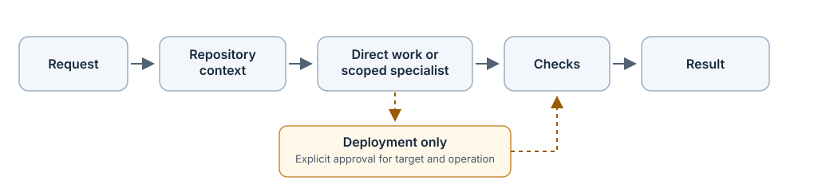

# Architrave

Architrave is a spec-driven development control plane for coding agents
(Copilot, Claude Code, Codex, OpenCode). Every non-trivial task starts as a few
requirement rows with testable acceptance in a repository file (`SPEC.md` or the
configured `requirements`). Work, child sessions, owner corrections and
hand-offs are traced to those REQ ids, and work is done only when the REQs are
accepted with evidence. Around that spec it adds durable resumable Runs,
bounded multi-session supervision, deterministic and judge-gated verification,
specialist roles grounded in your design system, contracts and runtime, and a
learning loop that turns repeated failures into checks.

It works from the system you already have: your code, design components,
architecture docs and tests. Small tasks stay direct; independent work splits
into scoped child sessions and comes back for checks and review. The plugin
supplies the contract, roles and skills; the optional repository kit adds
configured gates, durable Run records and reviewable learning. See the
[full capability set](#full-capability-set) and the plain-language guide to
[long programs](docs/long-programs.md).

## Spec-driven workflow

1. **Specify.** The request becomes REQ rows in `SPEC.md`: id, requirement,
   testable acceptance, owner, status. A bounded task needs one to three rows;
   read-only questions and one-line edits are exempt.
2. **Build and trace.** Commits, child kickoffs, hand-offs and reports name
   their REQ ids. When you change your mind, the change is recorded as a typed
   correction row (`add`, `revise`, `retract`, `supersede`) before the agent
   acts on it, so it survives context compaction and session restarts.
3. **Verify.** `accepted` needs evidence. `python gates/gate_runner.py
   requirements --done` passes only when every active REQ is accepted, and the
   independent review grades against the same rows.
4. **Hand off.** The `## Handoff` note (Next, Failed approaches, Verify) lets a
   fresh session resume in minutes without retrying dead ends.



## What you can use it for

- **Build UI from your own design system.** Use Storybook or the configured
  design source, real component names, and design tokens instead of a new
  one-off design. The UI roles cover navigation, keyboard interaction,
  empty/loading/error states, and visual details. Platform guidance covers
  Apple HIG, Microsoft Fluent, and web accessibility. With a token generator
  configured, the reconcile gate checks generated values against committed code.
- **Keep UI and backend in agreement.** Start with architecture docs and API/data
  contracts. Backend roles help with service boundaries, migrations, rollback
  plans, implementation, and tests. Full-stack work uses the same contract
  across the UI and service rather than planning each in isolation.
- **Design operational workflows.** The operations guidance covers setup and
  offboarding, inventories, uploads, roles and permissions, health, diagnostics,
  queues, and scheduled or long-running jobs. It connects what the UI displays
  to the data and action states the backend must provide.
- **Work on non-app repositories.** The knowledge profile grounds work in docs,
  scripts, skills, schemas, and tests without requiring Storybook or inventing
  a UI or backend.
- **Check the result, not just the build.** Run the repository's configured
  checks. Add independent review for semantic or higher-risk changes, and
  configured runtime evidence for app or deployment work: exercised workflows,
  screenshots, health, logs, and the deployed artifact's digest.
- **Keep the change small.** Reuse existing code, platform features, and installed
  dependencies before adding another abstraction. Compare alternatives when
  an architecture choice, migration, security concern, or recurring failure
  makes the decision worth examining.

## Child sessions and resumable work

Architrave keeps one lead responsible for the request and final integration.
Independent slices can run in coordinated child sessions with separate
worktrees and non-overlapping ownership. A brief assignment needs an objective,
owned scope, relevant context, and expected result. Add acceptance checks,
explicit budgets, and recovery detail when the task or risk needs them.
Children return compact results, not their entire transcripts.
The default is at most three active children, one level deep; `workers.maxParallel` raises it to at most eight. Multi-component programs (`components` with two or more entries) must configure a repository `requirements` file; the components gate fails without it. The file is a REQ table with acceptance, typed corrections and a `## Handoff` note; `python gates/gate_runner.py requirements [--claim REQ-1 --owner lane] [--done] [--handoff]` checks it, refuses duplicate lanes, decides done and, before session rotation, proves the hand-off is committed rather than stranded in a worktree-local ledger. Plain-language guide: [docs/long-programs.md](docs/long-programs.md).

On hosts with app-native session controls, the lead can create child sessions,
send them instructions, receive results, and inspect their status. In the
Copilot app, these use the host's `create_session`, `send_session_message`, and
session-status tools; children can appear separately in the sidebar.
Children report back to the lead rather than spawning grandchildren.
In a CLI, Architrave uses native subagents when available.
Work that follows one continuous trace or touches the same files stays direct.
Model and reasoning choices remain in your host settings.

Architrave uses the host's communication tools, not a separate agent-messaging
framework. The optional native bridge connects supported host tasks to the
durable Python harness for Run state, admission checks, and evidence. Ordinary
host-managed sessions and messaging do not require that bridge.

For longer work, an adopted repository can keep a **Run** under
`.architrave/runs/`. It records the requested outcome, acceptance criteria,
dependent tasks, permissions, checkpoints, checks, and evidence. A rolling
recovery snapshot and authenticated event history support resuming after an
interruption without treating the chat transcript as the task database.

Keep that work focused on one outcome: begin the first end-to-end slice when
its real blockers are known, and keep the task list to implementation, checks,
integration, and actual dependencies. The lead reports what the product can do
now and what proves it, not how many plans, tests, or receipts exist.

Independent tasks can continue while another waits for sign-in, signing,
consent, or another human decision. Scoped permissions and recorded deployment
results keep external actions separate from ordinary code edits. Uncertain
actions are checked before retrying; repeated identical failures stop that path.
An on-demand feasibility check helps choose whether to continue, narrow the
change, try another approach, or park it.

The lead integrates candidate changes and verifies the acceptance criteria.
Recorded checks are tied to the task and source being reviewed, so an old green
build or a worker's completion message cannot stand in for the current result.
An adopted Run can flag a primary product criterion as stalled after repeated
work does not touch its paths or change its outcome, then block unrelated task
starts not bound to that criterion. It requires a declared primary criterion;
it is not an idle timer.
See the [runtime guide](docs/runtime-v2.md) and
[execution policy](knowledge/execution-policy.md).

## See what is happening

The Copilot package includes two companion panels for hosts that support
extensions and canvases:

| Panel | What it shows |
|---|---|
| **Session companion** | Session activity, host-reported model and effort, context usage, and expandable SDK subagent rows with names, roles, assigned work, and lifecycle status. App-native child-session rows are not yet exposed by the host integration. |
| **Route Ribbon** | Run snapshots showing the route, workstreams, blockers, stops, retries, and evidence, with completed work kept separate from verified product results. |

The session companion observes host events without recurring model calls.
It follows the host theme, supports keyboard navigation and reduced motion,
and can be dismissed or opted out of.

See [panel setup and supported hosts](docs/route-ribbon.md).

## Keep useful knowledge between tasks

With learning configured, Architrave keeps a concise repository profile and
candidate lessons with supporting evidence. Repeated build gotchas, operational
facts, and conventions can become standing guidance after validation and review.
The learning helpers check local evidence and stale facts; semantic review can
flag unsupported prose and mark exact matching claims as unvalidated.

Task history stays in Run records, useful repository facts stay in the profile,
and promoted rules belong in the relevant instructions, docs, or config.
See the [learning guide](knowledge/learning-loop.md).

## Agents and skills

You can use the specialist roles directly or let Architrave select the relevant
ones. They are optional contexts, not a required procession for every task.

| Work | Roles |
|---|---|
| Coordination and decisions | **Architrave** leads the work; **CTO** helps resolve stalls or scope/budget decisions and, on owner request, oversees running programs across sessions; **Tournament Analyst** compares consequential alternatives. |
| Research and UI | **Product Research** finds source-backed patterns; **Operations UX** covers admin workflows; **UX Architect** handles flows and interaction; **UI Visual** handles appearance; **Platform Design** checks platform conventions. |
| Backend | **Service Architect** works through boundaries and contracts; **Backend Planner** sequences implementation and migration; **Backend Implementer** builds the approved slice and tests it. |
| Infrastructure and runtime | **Infra Engineer** plans scoped infrastructure work; **Runtime Observer** checks deployed or running behavior. |
| Review | **Adversarial Judge** reviews proposals and implementations against the repository and rubric, returning PASS, REVISE, or FAIL. |

The plugin also packages these focused skills:

| Skill | When to use it |
|---|---|
| `architrave` | Coordinate a non-trivial repository change. |
| `architrave-work` | Carry out one assigned development, research, or writing task in a child. Writing can use author-provided voice samples. |
| `architrave-cto` | Resolve an established stall or feasibility decision inline, without spawning another supervisor. |
| `architrave-tournament` | Compare material implementation alternatives. |
| `architrave-review` | Request a read-only rubric review of a proposal or implementation. |
| `architrave-agent-authoring` | Create, revise, or review a focused agent role. |
| `architrave-skill-authoring` | Create, revise, or package a skill with a clear trigger and supporting sources. |
| `architrave-mcp-integration` | Design or review an MCP tool contract, permissions, data flow, and failure behavior. |

Authoring skills are used when you ask for authoring work, not during routine
tool use.

### Third-party skills

These skills are vendored unchanged from their upstream repositories. Each
folder keeps its upstream licence file (`LICENSE` or `LICENSE.txt`), and the
copyright stays with the original authors.

| Skill | When to use it | Source | Licence |
|---|---|---|---|
| `verification-before-completion` | Run the proving command and read its output before claiming work is done. | [obra/superpowers](https://github.com/obra/superpowers) @ `2ce8aa1` | MIT, © 2025 Jesse Vincent |
| `systematic-debugging` | Find the root cause before proposing a fix for a bug or failing test. | [obra/superpowers](https://github.com/obra/superpowers) @ `2ce8aa1` | MIT, © 2025 Jesse Vincent |
| `subagent-driven-development` | Run a plan task by task with fresh subagents and a two-stage review (spec, then quality). | [obra/superpowers](https://github.com/obra/superpowers) @ `2ce8aa1` | MIT, © 2025 Jesse Vincent |
| `writing-skills` | Write or improve skills test-first. | [obra/superpowers](https://github.com/obra/superpowers) @ `2ce8aa1` | MIT, © 2025 Jesse Vincent |
| `skill-creator` | Create skills, run evals and benchmarks, and tune descriptions. | [anthropics/skills](https://github.com/anthropics/skills) @ `dbd4588` | Apache-2.0, © Anthropic |
| `webapp-testing` | Test local web apps end to end with Playwright. | [anthropics/skills](https://github.com/anthropics/skills) @ `dbd4588` | Apache-2.0, © Anthropic |

Where these overlap with Architrave, the Architrave contract and the configured
gates take precedence. For example, the `requirements` gate decides "done", and
the child cap applies to subagent dispatch. Anthropic's document skills
(docx/pdf/pptx/xlsx) are source-available rather than open source, so they are
not bundled.

## Install the plugin

Install Architrave in an agent client you already use.

With **GitHub Copilot** (CLI, desktop app, or VS Code):

```bash
copilot plugin marketplace add dragoshont/architrave
copilot plugin install architrave@architrave
```

With **Claude Code**:

```bash
claude plugin marketplace add dragoshont/architrave
claude plugin install architrave@architrave
```

With **Codex CLI**, from a local clone of this repository:

```bash
codex plugin marketplace add /path/to/architrave
codex plugin add architrave@architrave
```

Desktop plugin discovery is separate from CLI installation; see the
[host support notes](docs/orchestration-audit.md).

Start a conversation in the host, select or invoke Architrave, and describe
the change you want. Plugin-only use does not require modifying the target
repository. The plugin adds Architrave's host-specific instructions and
roles; it uses tools already available to the host.

For example:

> Add an empty state to the library list using our existing components. Include
> the loading and error states, and run the relevant tests.

## Optional repository setup

Install the kit into a repository when you want repo-local roles, configured
checks, or durable task records. Run the installer from an Architrave checkout
or installed kit, with the target repository as the final argument:

```bash
python3 /path/to/architrave/tools/install_update.py install /path/to/your/repo
```

For documentation, automation, or other repositories without a product UI,
use the knowledge profile:

```bash
python3 /path/to/architrave/tools/install_update.py install --profile knowledge /path/to/your/repo
```

Review the generated `architrave.config.json` and set real repository sources
and build/test commands before relying on its checks:

| Work in the repository | Configure |
|---|---|
| UI | Design source, component map, platform, tokens, and generation/build/test commands. Early projects can start with specs and Storybook before adding token generation. |
| Backend | Architecture docs, contracts, source paths, and backend build/test commands. |
| Infrastructure and runtime | Optional `iac`, `runtime`, and `ops` commands and scoped execution policy. |
| Learning | Profile, lesson, and artifact paths, plus validation and promotion rules. |

Repository adoption also installs managed grounding instructions and Copilot
cloud-agent setup. The knowledge profile installs only the roles appropriate to
that repository.

To generate the optional Codex project roles during setup, add `--codex` to
either install command. Plugin skills stay in the plugin rather than being
copied into the repository.

For durable Copilot workers and source-bound native review, install the
additional host bridge from the kit:

```bash
python3 /path/to/architrave/tools/install_update.py native-host-install
```

Then reload extensions through the supported host controls. The bridge provides
`architrave_native_dispatch`, `architrave_native_gate`, and
`architrave_native_review`, with status, cancellation, and recovery tools.
See [native review](docs/native-semantic-review.md) for the evidence contract.

With **OpenCode**, a durable WorkPacket can run in a child session of an
already-running local `opencode serve` (loopback only; the CLI is never
launched):

```bash
OPENCODE_SERVER_PASSWORD=... python3 /path/to/architrave/harness/opencode_host.py \
  --repo . --server http://127.0.0.1:4096 <run-id> <task-id>
```

The session is bound to the task's isolated worktree, uses an existing OpenCode
agent (`general` for edits, `explore` for read-only, or `--agent`), and returns
only a candidate; gates still run in the coordinator. OpenCode keeps its own
permissions and model choice. Pending permission prompts are reported, never
answered. A timeout interrupts the session and fails the task; if the session
cannot be confirmed stopped, the task keeps its lease until `worker-recover`.
This uses OpenCode's experimental `/api` surface, checked against one local
OpenCode release; Pi is not supported.

### Work that spans several repositories

When one product is built from several repositories (an app, a fork of an
engine you do not own, shims), list them in a coordination repository's
`architrave.config.json`:

```json
"components": [
  {"name": "engine", "repo": "you/engine-private", "path": "../engine", "upstream": "vendor/engine",
   "service": "make test"},
  {"name": "app", "repo": "you/app", "path": "../app", "consumes": ["engine"],
   "service": "swift test", "ui": "./scripts/e2e.sh"}
]
```

`python3 gates/gate_runner.py components` checks each local checkout: it must
not live in agent session scratch, and its branch must push to `repo`, never
to `upstream`. Unpushed commits and uncommitted files are reported as warnings.
Add `--test` to run each `service` command before its `ui` command; the UI
check is skipped when the service check fails. See
`kit/examples/coordination.architrave.json`.

The kit is Python only: run every gate, harness command and installer as
`python <file>.py` on macOS, Linux or Windows. Your project's build and test toolchain stays unchanged.

## Updates

Update the plugin through its host. For the Copilot and Claude command-line
clients:

```bash
copilot plugin update architrave
claude plugin marketplace update architrave
claude plugin update architrave@architrave
```

Plugin updates do not refresh kit files copied into adopted repositories. Run
the updater from the updated kit to refresh those files:

```bash
python3 /path/to/architrave/tools/install_update.py update /path/to/your/repo
```

The updater leaves the repository's config and local agents alone by default.
Use `--agents` only when you also want to refresh copied Architrave roles; use
`--codex` to refresh generated Codex project roles.

## Checks and experiments

The repository includes fixture tests and a benchmark harness for mechanical
changes, features, multi-surface work, recovery, deployment policy, and authoring
tasks. It records validation results, changes, time, tokens, interventions, and
optional review scores. List scenarios without starting an agent run:

```bash
python3 scripts/bench-architrave.py --list
```

See the [benchmark guide](docs/longbuild.md) and
[orchestration audit](docs/orchestration-audit.md) for how experiments are run
and interpreted.

## Host boundaries

Plugin installation adds instructions, roles, and skills, not missing tools or
MCP servers. Checks must be configured and invoked; Architrave does not intercept
every host tool call. Worktrees and scope checks separate changes but are not an
OS security sandbox. Infrastructure starts as plan-only work; applying changes
requires permission for the target and operation.

## Full capability set

Everything Architrave ships, grouped by area. Paths point at the source of truth.

### Specification and requirements
- Requirements file with REQ rows (id, requirement, acceptance, owner, status, evidence), typed correction rows and a Handoff note — `kit/examples/requirements.md`, `SPEC.md` default or config `requirements`.
- `requirements` gate: validates the table, testable acceptance, evidence for accepted rows, corrections for superseded or withdrawn rows, correction targets and the Handoff note; `--claim <ids> --owner <lane>` refuses duplicate, accepted or closed lanes and prints acceptance plus corrections for the kickoff; `--done` decides completion; `--handoff` fails on uncommitted requirements or newer progress in this checkout's SDD ledger and warns about one in a sibling worktree — `gates/gate_runner.py`.
- `checks` and `quality-gate` validate the requirements file whenever one exists, and `components` fails a multi-component program without one — `gates/gate_runner.py`.
- Run v2 binds tasks to REQ ids, records claims as events and refuses completion while bound REQs are not accepted — `harness/architrave_runtime.py`, `docs/runtime-v2.md`.
- Upfront challenge at intake: contradictions, risky assumptions and better approaches are named before work starts — `agents/architrave.agent.md`.
- Tournament of Options for architecture, migration, security, data-loss and recurring-failure decisions, with "do nothing" and "smallest viable" baselines — `skills/architrave-tournament/`, `agents/tournament-analyst.agent.md`.
- YAGNI ladder as a gate: delete, reuse, platform feature, then the smallest new code — `knowledge/yagni.md`.

### Supervision and multi-session work
- One lead owns integration; children get an objective, owned scope, REQ ids and expected result, and return compact results — `agents/architrave.agent.md`, `knowledge/execution-policy.md`.
- Child cap `workers.maxParallel` (default 3, up to 8), depth one, exclusive mutable ownership, enforced in the runtime and native dispatch — `harness/architrave_runtime.py`, `extensions/architrave-native/bridge.mjs`.
- App-native child sessions in the Copilot app, native subagents in CLIs; never shells out to another agent harness — `harness/platform_launch.py`.
- Component map: one writer per component repository, push only to its own repo, never upstream, service tests before UI tests — `gates/gate_runner.py components`, `kit/examples/coordination.architrave.json`.
- Destination preflight: a child verifies repository, workspace and branch before writing — `skills/architrave-work/SKILL.md`.
- Repeated-failure stop: the same failure fingerprint twice without new evidence stops the lane; a stalled primary criterion blocks unrelated new tasks — `harness/architrave_runtime.py` (`STALLED_PRIMARY_CRITERION`).
- Coordinator rotation into a fresh session seeded from the requirements file, not the transcript — `agents/architrave.agent.md`.
- CTO role for an established stall, scope or budget decision, a feasibility reset with a finite evidence window, or owner-requested cross-session program oversight on a host-owned schedule — `agents/cto.agent.md`, `skills/architrave-cto/`.

### Durable Runs and recovery
- Run v2 state machine with API-owned state, authenticated event log, checkpoints and a rolling recovery snapshot; phase and status views are projections — `harness/architrave_runtime.py`, `knowledge/runtime-v2.md`.
- Task graph with dependencies, WorkPackets, worker completion recorded separately from task PASS, objective versioning, primary criterion and milestones — `harness/architrave_runtime.py` (`task-add`, `primary-set`, `criterion-set`, `milestone-advance`, `objective-replace`).
- `WAITING_EXTERNAL` checkpoints for human sign-in, approvals and external systems, resolved only by trusted actors — `knowledge/runtime-v2.md`.
- Default-deny mutation: infrastructure and runtime changes need scoped grants, target attestation, receipts, reconciliation of uncertain side effects and live verification — `harness/architrave_runtime.py` (`policy-check`, `reconcile-side-effect`, `target-attest`).
- Worker adapters (native host, command, external) and git-backed isolated workspaces with collect, integrate and cleanup — `harness/worker_adapters.py`, `harness/workspaces.py`.
- Invariant engine for declarative product and safety invariants — `harness/invariant_engine.py`.
- Run v1 to v2 migration — `docs/migration-run-v1-v2.md`; validation — `harness/validate_run_v2.py`, `harness/architrave_cli.py validate-run`.
- Long-build runtime guidance — `docs/longbuild.md`.

### Native host bridge (Copilot)
- `architrave_native_dispatch` and `_batch` (2–8 pre-decomposed packets) dispatch bounded WorkPackets through the joined host with owner binding, child limits, source binding and REQ acceptance in the kickoff — `extensions/architrave-native/bridge.mjs`.
- `architrave_native_status`, `_cancel` (through the real owner, never a fabricated result) and `_recover` (closes orphaned records without replaying side effects).
- `architrave_native_gate` runs stored commands or observes configured workflows bound to the source, task and objective; `architrave_native_review` runs one fresh source-bound semantic review and admits only observed results — `docs/native-semantic-review.md`.

### Verification and review
- Deterministic gates in one Python CLI (`python gates/gate_runner.py <gate>`): `checks`, `reconcile` (design tokens against code), `quality-gate`, `backend-checks` (build, tests, migration safety, secret scan, IaC plan and policy, never apply), `components`, `requirements`, `message-lint` (owner-message identifiers) — `gates/`.
- Risk-scaled verification: R0/R1 deterministic, R2 one fresh-context reviewer, R3 adds real end-to-end or runtime evidence, R4 adds security and policy review; cross-family review with `review.crossFamily` — `gates/rubric.md`, `knowledge/execution-policy.md`.
- Adversarial Judge with a PASS, REVISE or FAIL rubric covering spec conformance, root cause, YAGNI, UX, visual fidelity, accessibility, backend security, runtime and evidence — `agents/adversarial-judge.agent.md`, `gates/rubric.md`.
- Semantic and tournament review launchers for Copilot, Claude or both — `harness/architrave_cli.py semantic-review`, `harness/architrave_cli.py tournament-review`.
- Application legibility: health, release and deployment checks against the deployed artifact — `harness/legibility.py`, `docs/application-legibility.md`.
- Explicit quality cadence rather than automatic hooks, plus safe retirement of legacy hooks — `docs/quality-check-cadence.md`.

### Specialist roles and grounding
- Fourteen roles: Architrave, CTO, Product Research, Operations UX, UX Architect, UI Visual, Platform Design, Service Architect, Backend Planner, Backend Implementer, Infra Engineer, Runtime Observer, Tournament Analyst and Adversarial Judge — `agents/`.
- UI grounded in Storybook or the configured design source, design map and tokens; platform packs for Apple HIG, Microsoft Fluent 2/WinUI and Web/WCAG 2.2; native constitutions — `knowledge/apple.md`, `knowledge/microsoft.md`, `knowledge/web.md`, `knowledge/design-tokens.md`, `constitution-apple.md`, `constitution-windows.md`.
- Backend grounded in architecture docs and API/data contracts, with reversible migrations and rollback plans — `knowledge/backend.md`.
- Operations UX for onboarding, offboarding, inventories, uploads, roles, health, diagnostics, jobs and degraded states — `knowledge/operations-ux.md`.
- Repository profiles: application (UI, backend, IaC, runtime lanes) and `kind: knowledge` for docs, skills and automation repositories — `kit/architrave.config.schema.json`, `kit/examples/`.

### Learning and self-improvement
- Four memory stores with a candidate-lesson queue, promotion after repeated occurrences and human approval — `knowledge/learning-loop.md`, `harness/promote-lesson*.{sh,ps1}`.
- Executable-first promotion, improvement proposals approved only with before/after evidence and a human, and a harness pruning review per model release — `harness/improvement.py`, `knowledge/learning-loop.md`.
- Stale-fact guards: deterministic link checks, semantic review of prose claims and exact-line `UNVALIDATED:` marking — `harness/architrave_cli.py mark-stale-learning`, `harness/architrave_cli.py semantic-learning-review`.
- Learning validation with a secret scan — `harness/validate_learning.py`.

### Skills
- Architrave skills: `architrave`, `architrave-work`, `architrave-cto`, `architrave-tournament`, `architrave-review`, `architrave-agent-authoring`, `architrave-skill-authoring`, `architrave-mcp-integration` — `skills/`.
- Vendored third-party skills (see [Third-party skills](#third-party-skills)): `verification-before-completion`, `systematic-debugging`, `subagent-driven-development`, `writing-skills`, `skill-creator`, `webapp-testing`.

### Observability
- Route Ribbon canvas: route, blockers, children and evidence from canonical snapshots; Session companion: activity, model, effort and context usage — `docs/route-ribbon.md`, `harness/ribbon.py`.

### Install, update and hosts
- Plugin for Copilot CLI/app, VS Code, Claude Code and Codex/ChatGPT; OpenCode host adapter — `plugin.json`, `.claude-plugin/`, `.codex-plugin/`, `harness/opencode_host.py`.
- Per-repository installer: `install`, `update`, `executor-install`, `native-host-install`, `canvas-install`, `companion-install`, `adoption-status`; atomic, hash-pinned, symlink-safe writes — `tools/install_update.py`.
- Windows support through the same Python entrypoints.
- Codex project roles generated from the agents — `tools/codex-roles.py`, `.codex/agents/`.

### Benchmarks and research
- Scenario and routing benchmarks with a judge rubric, results schema and human-review procedure — `benchmarks/`.
- Orchestration audit and a measured spec-driven footprint trial — `docs/orchestration-audit.md`, `scripts/measure-basic-sh-sdd.py`.
- Research behind the long-program design, with sources — `docs/long-programs.md`, `benchmarks/RESEARCH.md`.

## Further reading

- [Repository adoption and migration](kit/MIGRATION.md)
- [Configuration examples](kit/examples/)
- [Execution policy and host limits](knowledge/execution-policy.md)
- [Runtime and durable task records](docs/runtime-v2.md)
- [App and deployment verification](docs/application-legibility.md)
- [Design tokens and reconciliation](knowledge/design-tokens.md)
- [Apple](knowledge/apple.md), [Microsoft](knowledge/microsoft.md), and [web](knowledge/web.md) guidance
- [Explicit quality-check cadence](docs/quality-check-cadence.md)
- [YAGNI guidance](knowledge/yagni.md)
- [Changelog](CHANGELOG.md) · [GitHub releases](https://github.com/dragoshont/architrave/releases)
