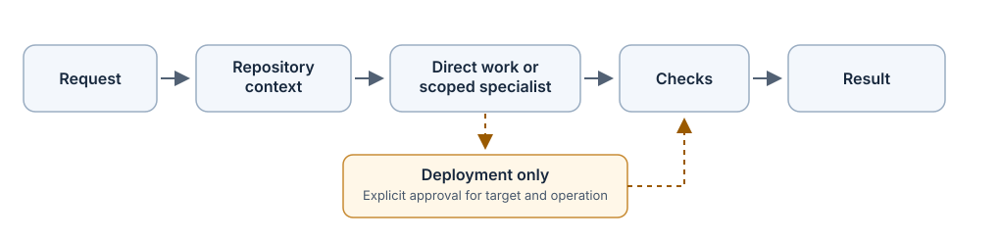
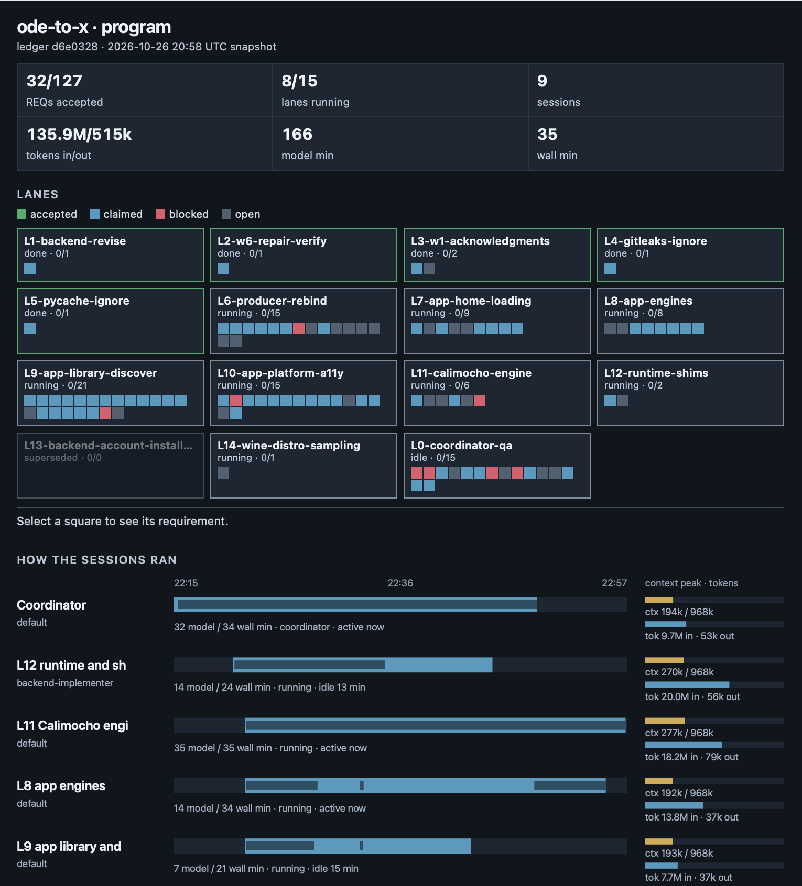

# Architrave

**Research. Decide. Build. Challenge. Deliver.**

Architrave is a lean, multi-agent engineering orchestration framework that
coordinates research, decisions, implementation and adversarial review across
persistent sessions and multiple repositories, maintaining evidence and
accountability from initial investigation to verified delivery. It runs as a
plugin for Copilot, Claude Code, Codex and OpenCode, and uses the host's own
sessions, tools and permissions rather than its own runtime.

Current structured work lives in **`.architrave/state.yaml`**, through
`python harness/architrave_cli.py state`. The [lifecycle API](docs/lifecycle-state.md)
maintains stable tasks, original sources, scoped corrections/decisions, attempt
ownership, evidence and idempotent receipts in one locked snapshot. Existing
`tasks.md` is a deterministic migration input or generated read-only view, never
a competing writer after selection. Progress remains blank, **In progress** or
**Code ready**, separate from acceptance and disposition. The program board and
scoped agent context read the same revision without model-generated factual fields.
Preserve the owner's requests and corrections and verify actual behavior. The obsolete
SPEC/REQ completion barrier is retired; automatic loop detection remains.
Do not create a SPEC, delivery declaration or extra approval stage to close a turn.

The requirements/Run tools below are retained for explicitly selected legacy
workflows. They are not the current default or a `task_complete` prerequisite.
They cannot compete with selected lifecycle task authority. An explicitly
selected safety-only Run or lifecycle-operation capsule retains scoped policy,
checkpoints, receipts and reconciliation without reactivating legacy dispatch.

**1.1.0 lifecycle implementation.** Uses a bounded, JSON-compatible YAML
1.2 profile without new dependencies; preserves stop/unknown ownership and late
results, rejects stale writes and competing task edits, and records external
uncertainty without executing host actions. See [evidence and limits](docs/lifecycle-evidence.md).
Source changes do not reload a running plugin, authenticate human provenance,
or demonstrate a behavioral benchmark gain.

**1.1.1 corrective pass.** Explicit consumed-output selection and frozen bindings
separate artifact applicability from ordering. Comparable-check conflicts and
linked reruns remain visible without turning integration into acceptance.
Filesystem-aware ownership preserves case-distinct work where observed and
handles unknown lookup behavior conservatively. Old state is not silently
rebound; see the lifecycle API's compatibility and qualification boundaries.

**1.2.1: domain-aware corrective release.** The existing Service
Architect now follows source-backed business language, rules, ownership and
consistency into technical contracts, with a read-only application-audit operation
using the same Judge. Functional/procedural designs and monoliths are valid;
routine work needs no modeling ceremony. No new role, lifecycle, DDD flag or
architecture dependency is added. See the [replacement and evidence record](docs/domain-release-evidence.md).
The Backend Implementer accepts already-authorized work without mandatory
Planner sign-off. Real native-host trials now exercise source discovery,
Python/TypeScript/C# behavior, read-only audits and live correction/resume.
The stable distribution channel does not imply universal agent correctness:
the small matched sample retains failures and demonstrates no performance gain.
Exact outcomes, independent review scope and remaining limits are in that record.

**1.1.0 bundled work board.** A shared Python/HTML/CSS/SVG renderer now
provides scoped progress, a task map/list and evidence inspector, source-backed
session observations, separate verification categories, theme and controlled
refresh. Optional host-authored AI interpretation stays advisory and YAML-backed;
opening or refreshing the board never calls a model. It ships through the
existing installer, with a self-contained browser export and no separate plugin
or frontend build. See [dashboard usage](docs/dashboard.md).

| Stage | What the file records | What the gate enforces |
|---|---|---|
| **Research** | Evidence rows: question, source, claim, author, status, reviewer | A supported claim has a reviewer other than its author. Web sources carry a retrieval date. `<repo>@<commit>:<path>` sources must resolve in a configured local checkout. They fail as stale once that file changes, but only when the checkout's HEAD contains the cited commit; otherwise freshness is reported as unverified |
| **Decide** | Decision rows: choice, rejected alternatives, evidence | An active decision rests only on supported evidence. A REQ can't be accepted on a decision under reconsideration |
| **Build** | REQ rows, owner corrections and the cross-repository lane table | One live owner per REQ and path; running lanes within `workers.maxParallel`; one heavy build at a time; dependencies done before a lane runs; running lanes have full session IDs; supersessions name an existing lane. Preflight and restart reconciliation are coordinator behavior, not gate checks |
| **Challenge** | Finding rows from any review: severity, disposition, verifier, evidence | A fix needs a commit that resolves in a configured checkout, or an existing evidence or decision id; agreement alone doesn't count. A serious finding needs a verifier who isn't the target's owner or author. Deferral needs a quoted owner acknowledgement, which the gate can't authenticate. Open high findings block completion |
| **Deliver** | Code-ready tasks, final evidence and review, and a committed `## Handoff` | Repository-wide `--done` checks all REQs; declared `--done --delivery-session` checks its selected requirements and relevant dependencies. Unfinished code, missing final evidence, narrowing or serious findings in that scope block completion. `--handoff` requires committed state and its predecessor commit |

Tables that look like these but use different headers fail rather than being skipped. The gate checks identity, provenance, freshness and links. Whether a source
really supports its claim is the independent reviewer's call. The adversarial
judge rebuilds high-risk claims from their sources and re-checks earlier
audits, and agreement between agents never counts as evidence.

Declared work binds explicit owned sources and dependencies, not every unrelated
writer in a shared checkout. Unchanged outcomes retain valid evidence across
scope additions; changed dependencies still require fresh proof. A recorded
blocked, waiting or handoff outcome ends that attempt without accepting its
delivery. See [delivery authenticity](docs/delivery-authenticity.md). Automated
continuation is not new owner approval, and proposed work stays proposed until
the owner agrees.
The read-only `delivery-audit --completion-summary` recovery command follows
the current lifecycle: an initial non-delivery termination is distinct from
an eligible follow-up after real host completion. It does not resume or
accept stopped work.
After verified completion, ordinary nonempty read-only replies need no special
summary prefix. Recorded repository edits still require a newer owner-bound scope;
active work and the exact first non-delivery termination keep their strict checks.

**What is demonstrated and what is not.** In a live run on a multi-repository
program, a coordinator committed the lane table, reused existing sessions, and
dispatched lanes through the Copilot app. One child session delivered and
passed independent review, and that whole chain is recorded in the program
ledger. The gate caught a real file-ownership conflict and short session IDs.
Two lanes could not run: a turn started by another session cannot show the
owner a permission prompt. Sustained parallel delivery across many children
(REQ-30/36) is **not yet proven**. Validation evidence is recorded per release; publication is explicit.
Check live workflow state rather than assuming repository automation is disabled.

**1.0.6.** Clarifies the final handoff without changing the working loop:
Code ready includes in-scope wiring, accepted review fixes are rechecked on
integrated source, and publication reports the actual feature PR separately
from review and runtime readiness. These are instruction changes, not new hooks
or approval stages; unavailable credentials do not make written code unfinished.

**1.0.5.** Retires SPEC/REQ completion blocking, including a compatibility no-op
for retained hook commands. The board reads tasks.md without requiring a SPEC or
REQ selection, and the lead/skill follow that same task source. Historical
evidence stays unchanged. Normal host permissions and owner stops still apply.
Worker guidance now separates preparation, ownership-held, implementation,
checking and handback. A bounded standalone-shell-wait advisory discourages
synthetic busy waits without treating real testing or ownership holds as stalls.

**1.0.4.** A local Copilot hook automatically detects four identical
read/search results within 24 observations and injects a corrective nudge.
The bounded fingerprint cache survives resume; reminders are suppressed for
unchanged evidence. This is advisory repetition detection, not a guarantee of
agent recovery: it never blocks tools, forces edits or overrides stops.
The guidance also respects the owner's chosen Autopilot mode and existing
scoped grants. Installing an update does not refresh already-running sessions.
See [hook coverage and limits](docs/quality-check-cadence.md#automatic-repeated-investigation-detection).

**1.0.2 source build.** The adversarial fixes cover native ownership and timing,
immutable retry results, overlapping mutable scopes, installer path safety,
delivery-source freshness, and task-authorized iOS installation. See the
[changelog](CHANGELOG.md) for the behavior changes. These fixes are included in the public 1.0.4 release.
Synthetic regression coverage is not live-host qualification.
The original reviewer clarified that the earlier source-readiness PASS covered
REQ-60 and REQ-63. The local quality gate now passes with that reviewer history
available; the clarification is not installed or runtime proof.

**1.0.1 packaging.** This release restores the full v1.0.0 plugin, including
its Python code and Copilot hooks, after the instructions-only reduction.
The host's plugin manager installs the complete package. There is no separate
compilation step; a Git source archive is the local build. Existing qualification
limits below still apply.

**1.0.0 source scope.** The current code adds source-bound candidate integration,
restart-safe native ownership, shared status/admission checks, observed option
comparisons within an existing finite allowance, and exact owner-event-approved
learning application and rollback. Task progress uses Not started, Started and
Code ready; review and final evidence apply to the complete feature set.
These implementation capabilities do not imply that every target or live-host
failure mode has been qualified.

**Historical beta qualification.** 1.0.0-beta.1 is a prerelease, not 1.0 final.
Native Windows and macOS are
the 1.0 targets; WSL2 is not. The work makes CLI-created Runs honor the configured autonomy and mutation-policy
defaults, reports each Run's execution, holds and one next action from
canonical state (a conservative, best-effort mirror of `task-start`, which stays
authoritative), bounds native dispatch stages, and adds continuation and
handoff guidance. Recovery retains uncertain ownership instead of treating an
empty listing as proof of absence. Attempts carry an identity; preflight shares
one deadline, abort signals are honored, and uncertain admissions reserve
capacity. Native resume/recovery refuses to release unconfirmed ownership.
Task-specific review binding, proposal-only learning and removal of unused
controls are included; broader delivery outcomes remain tracked in `SPEC.md`.
MacOS command-level checks are separate from live host qualification.
Genuine persistence-hang/lost-reply fixture coverage remains incomplete.
This does not demonstrate a live multi-wave qualification or sustained parallel
delivery, a live native-bridge hang (fixture-tested only), host
loading of a prerelease version, loaded-context refresh after an update, or an
owner and ACL check of the durable Run key on Windows. Every unaddressed item is
a GitHub issue (#40 to #87, including audit findings F6, F8, F9 and F10); the
handover for continuing on another machine is #39. See the
[changelog](CHANGELOG.md).

## Spec-driven workflow

Development follows the [case-by-case loop](knowledge/execution-policy.md#development-loop):
acceptance/design, implementation, focused checks and authorized scoped commit.
Material specification ambiguity stays held for sidebar research while
independent cases continue; a sourced, owner or tournament decision is recorded
as a REQ correction before release.
All in-scope cases must be code ready before two independent final sidebar
reviews by default; accepted findings become REQ corrections routed to fresh
implementers and are resolved before authorized deployment. Recover that phase after interruptions.
Ground blocking restrictions in owner direction, applicable policy or evidence;
do not promote agent assumptions into requirements or bypass real holds.
Recover repeated unchanged investigation from the current case, not another
round of rereading. Honor scoped stops despite automatic continuation; do not
count inherited branch history as new implementation.
Code ready records written implementation, not successful runtime qualification.
Permission and qualification holds still block their dependent operations and
delivery acceptance, not independent source review.
Review routing and deployment technology come from the task, not a global default.

1. **Specify.** The request becomes REQ rows in `SPEC.md`: id, requirement,
   testable acceptance, owner, status. A bounded task needs one to three rows;
   read-only questions and one-line edits are exempt.
2. **Build and trace.** Commits, child kickoffs, hand-offs and reports name
   their REQ ids. When you change your mind, the change is recorded as a typed
   correction row (`add`, `revise`, `retract`, `supersede`, `narrow`) before the
   agent acts on it, so it survives context compaction and session restarts.
3. **Finish the code, then perform required review.** Task statuses are **Not started**,
   **Started** and **Code ready**. Mark a feature Code ready when its
   implementation is finished, without waiting for review. When the owner or risk
   policy requires review, review the complete feature set together only after all
   feature code is ready, not feature by feature.
   `python gates/gate_runner.py requirements --done` checks the final evidence
   and review; Code ready alone does not pass that check.
4. **Hand off.** The `## Handoff` note (Next, Failed approaches, Verify) lets a
   fresh session resume in minutes without retrying dead ends.

See the [full capability set](#full-capability-set) and the plain-language
guide to [long programs](docs/long-programs.md).

**Session delivery audits.** `architrave-review` can assess explicitly selected
real Copilot sessions or a turn, including sessions without Architrave. The
[audit path](docs/session-audit.md) separates original-goal outcomes from token
consumption and approach, then shows evidence-backed prompt, instruction and
workflow proposals on the existing scoped board. Collection is local and
deterministic; semantic assessment uses the host reviewer. Nothing is applied
automatically and no productivity improvement is claimed from token counts.
For an explicitly owner-approved change, the existing lead can apply
[critical-path recovery](docs/session-audit.md#owner-approved-critical-path-recovery):
keep integration ownership, execute the next missing outcome, isolate genuine
blockers and observe subsequent work. This is instruction-driven host steering,
not an automatic watchdog or permission override.
Declared canonical Runs now require a shared finite recovery window after
milestone-free churn; labels, path touches and task/lane renames do not replenish
it. Direct host tools are not covered by that admission control. Copilot context
work reuses native compaction and selected SPEC/Handoff retrieval, while audits
report compaction consumption separately from ordinary calls.
Specification guidance and independent review require owner-goal coverage,
discriminating observable acceptance and explicit row-to-detail bindings, not
an execution diary or a passing-test substitute for the requested behavior.

Native work selects an explicit Run and exact REQ corrections rather than loading
all history. Explicit `global` rules remain current; ambiguous legacy targets
remain visible but cannot grant permissions. Managed cross-run scratch selection
is rejected, and selected source citations are checked against HEAD, index and
worktree. Same-run resume retains evidence with existing binding checks. These
are source/control-plane safeguards, not a host sandbox or automatic semantic
staleness detector. Keep a concise, source-cited project map in existing repo
instructions or the [optional repo profile](knowledge/learning-loop.md#repo-profile-shape).

## Delivery authenticity and default-session startup

The Copilot plugin adds a small session-start pointer to Architrave, not a full
crew of always-loaded instructions. Current work is tracked in tasks.md; the
tasks board shows its actual progress and is opened when available.
Read-only questions, trivial edits and assigned child reviewers do not create
another coordinator or require a declaration.
Its read/search hook automatically nudges repeated unchanged investigation;
it does not run quality checks after every tool or force continuation.

Do not introduce fixtures, fakes, mocks, stubs, canned/replayed provider results
or feature/integration flags without an explicit user request for that purpose
and scope, including new test-only substitutes. Preserve existing tests and
safety controls. Approved official local DTS/Azurite and publishing-time Azure
endpoint/adapter selection remain valid; they do not authorize fake application
results or establish cloud deployment.

The optional legacy `delivery-audit` inventories source/config/launcher/test candidates, binds source
and contract identities to an explicit Git base, and retains original owner and
visual-reference identities. Candidate words are not printed as values and do
not automatically establish authorization. Review compares owner intent,
requirements/docs, actual wiring, effective configuration and same-run
provider/result evidence. Source-only, rendered and runtime claims stay separate.

The SPEC/REQ `task_complete` barrier is retired. Old declarations are retained
as historical evidence, not read or rewritten by retained completion commands.
The optional legacy checks remain explicit tools, not automatic prerequisites.
Missing evidence, a disabled provider or old-result readback still cannot
establish a fresh integration: the agent must verify the requested behavior.
No full post-edit quality hook, forced-continuation loop or permission bypass is
added. The inventory is heuristic; a clean scan is not integration PASS.

See [the workflow, commands and exact limits](docs/delivery-authenticity.md).
The startup and advisory loop hooks target Copilot's documented event format;
Codex/ChatGPT use the task guidance without a claimed equivalent loop detector.



## What you can use it for


Use the smallest relevant part, not every role for every task. These are work
categories, not a promise that every host can execute every operation.

| Use case | What Architrave helps you do | Grounding and boundary |
|---|---|---|
| **Research, knowledge and writing** | Verify sources, compare findings, preserve decisions, write documentation, and maintain scripts, schemas and non-app repositories. | The knowledge profile uses repository sources and evidence; it does not invent a UI or require Storybook. Writing can use author-provided voice samples. |
| **UI, native UX and operations** | Build with your design system; improve navigation, keyboard behavior, accessibility and visual details; design setup, offboarding, roles, uploads, queues and diagnostics. | Configured Storybook/design sources and tokens; Apple HIG, Microsoft Fluent or web guidance. Operational states must agree with the backend. |
| **Backend and full-stack development** | Define service boundaries and API/data contracts, implement approved slices, and plan migrations and rollback across UI and services. | Existing architecture and contracts; relevant builds/tests and actual integration evidence, not independent incompatible plans. |
| **Debugging and maintenance** | Reproduce defects, trace root causes, refactor, reconcile old branches and remove proven unused or unwired code. | Existing consumers and regression checks. An unused-looking file or a passing build is not sufficient evidence for deletion or correctness. |
| **Cross-repository and long-running delivery** | Coordinate independent owned slices, integrate candidates, preserve task evidence and resume interrupted work. | Native host sessions and optional adopted Runs; exclusive ownership, bounded capacity and explicit recovery. Sustained autonomous multi-wave delivery is still being qualified. |
| **Review, decisions and recovery** | Adversarially review a proposal or result, audit selected real sessions, compare material alternatives and resolve a genuine stall. | Original criteria and source-bound evidence. Tournaments and CTO oversight are selective, not mandatory ceremonies or automatic watchdogs. |
| **Infrastructure and runtime operations** | Produce infrastructure plans and inspect health, logs, versions, deployed digests and actual application behavior. | Plan/read-only by default. Apply, deployment, rollback and runtime mutation need exact scoped authorization, receipts and live verification. |
| **Release and installation qualification** | Check source/version/package identity, canonical installation/update behavior, actual loaded builds and rollback evidence. | Explicit operation permission and the claimed host/OS matrix. Source tests and an installed digest alone do not prove a working release. |
| **Agent, skill and MCP authoring** | Create or revise focused roles and reusable skills, or design/review an MCP integration's tools, permissions and failure behavior. | Explicit authoring requests use the corresponding skills; routine tool use does not start an authoring workflow. |
| **Repository learning and oversight** | Capture evidence-backed candidate lessons and repo facts, assess improvement proposals, and oversee selected programs when requested. | Optional, source-checked and off the delivery path. Native memory/history are not grants; automatic self-rewriting or universal performance improvement is not promised. Learning apply-path hardening remains in progress. |

- **Keep the change small.** Reuse existing code, platform features, and installed
  dependencies before adding another abstraction. Compare alternatives when
  an architecture choice, migration, security concern, or recurring failure
  makes the decision worth examining.

The [approved delivery redesign](ROADMAP.md#approved-delivery-redesign-req-101108)
is implementation work, not a claim that the proposed Done-first loop or all
qualification scenarios already pass.

## Child sessions and resumable work

Architrave keeps one lead responsible for the request and final integration.
Independent slices can run in coordinated child sessions with separate
worktrees and non-overlapping ownership. A brief assignment needs an objective,
owned scope, relevant context, and expected result. Add acceptance checks,
explicit budgets, and recovery detail when the task or risk needs them.
Children return compact results, not their entire transcripts.
The default is at most three active children, one level deep; `workers.maxParallel` raises it to at most twenty. Multi-component programs (`components` with two or more entries) must configure a repository `requirements` file; the components gate fails without it. The file is a REQ table with acceptance, typed corrections and a `## Handoff` note. `requirements --claim REQ-1 --owner lane` writes ownership (commit before dispatch); `--done` checks acceptance; `--handoff --expect <predecessor-sha>` checks committed handoff state and successor ancestry. Claims use a single coordinator writer, not a cross-branch lock. Plain-language guide: [docs/long-programs.md](docs/long-programs.md).

On hosts with app-native session controls, the lead can create child sessions,
send them instructions, receive results, and inspect their status. In the
Copilot app, these use the host's `create_session`, `send_session_message`, and
session-status tools; children can appear separately in the sidebar.
Children report back to the lead rather than spawning grandchildren.
In a CLI, Architrave uses native subagents when available.
Work that follows one continuous trace or touches the same files stays direct.
Model and reasoning choices remain in your host settings.

For cross-repository programs in the Copilot app, one committed `## GHC
Scheduler` lane table in the requirements ledger holds repo/project, branch,
push target, REQ dependencies, session/assignment IDs, state and owner-only
decisions. The lead
drives dependency-ready lanes through the app's native session tools while
enforcing REQ ownership, mutable paths, `workers.maxParallel`, preflight and
the shared heavy-build slot. Commit every lane transition. After a coordinator
restart, reconcile with `get_sessions_status` and inspect idle, missing or
unknown sessions with `get_session`—absence never causes automatic respawn.
Permission denials are reported once, not bypassed. This is explicit lead
behavior, not a daemon or monitor.

Architrave uses the host's communication tools, not a separate agent-messaging
framework. The optional native bridge connects supported host tasks to the
durable Python harness for Run state, admission checks, and evidence. Ordinary
host-managed sessions and messaging do not require that bridge.

For longer work, an adopted repository can keep a **Run** under
`.architrave/runs/`. It records the requested outcome, acceptance criteria,
dependent tasks, permissions, checkpoints, checks, and evidence. A rolling
recovery snapshot and authenticated event history support resuming after an
interruption without treating the chat transcript as the task database.

Keep that work focused on one outcome: begin the first end-to-end slice when
its real blockers are known, and keep the task list to implementation, checks,
integration, and actual dependencies. The lead reports what the product can do
now and what proves it, not how many plans, tests, or receipts exist.

The lead and CTO challenge invented precaution gates: optional backups or VM
snapshots do not block routine already-authorized experiments, and phase
boundaries do not request the same approval again. Dedicated experimental hosts
make optional safeguards proportional, not unrestricted. Actual host permissions,
Run checkpoints, consent and destructive-operation boundaries still apply.
For routine desktop steps the lead prefers supported target-only window control
through the existing exclusive input owner; CTO steers that owner, never takes
input. Missing windows is not permission denial. Reports distinguish instructions
sent, execution started, observed results and accepted outcomes; screenshots and
passing source tests do not prove installed/native success.

Independent tasks can continue while another waits for sign-in, signing,
consent, or another human decision. Scoped permissions and recorded deployment
results keep external actions separate from ordinary code edits. Uncertain
actions are checked before retrying; repeated identical failures stop that path.
An on-demand feasibility check helps choose whether to continue, narrow the
change, try another approach, or park it.

The lead integrates candidate changes and verifies the acceptance criteria.
Recorded checks are tied to the task and source being reviewed, so an old green
build or a worker's completion message cannot stand in for the current result.
An adopted Run can flag a primary product criterion as stalled after repeated
work does not touch its paths or change its outcome, then block unrelated task
starts not bound to that criterion. It requires a declared primary criterion;
it is not an idle timer.
See the [runtime guide](docs/runtime-v2.md) and
[execution policy](knowledge/execution-policy.md).

### Program oversight (CTO)

When you run several long programs at once, ask the CTO to watch them, for
example "review these threads every 30 minutes". That oversight schedule is a
host session automation; the lead's explicit GHC lane coordination is separate
and does not add a daemon or polling loop. Each CTO pass:

- measures progress against each program's real goal, such as a game observed
  rendering, and treats commits, audits and status messages as activity only;
- runs `requirements --handoff` so each program keeps one committed ledger,
  and checks that every finished task has its gates, one independent review
  and recorded evidence;
- compares what sessions said they did with commits and evidence, and flags
  claims without proof or promised steps never taken;
- spots loops (the same failure, audit or message repeated) and breaks them
  with one different concrete action, or parks the path;
- answers routine questions and needless approval requests within the agreed
  direction, and queues decisions only you can make (consent, credentials,
  purchases, accounts, security bypass, destructive cleanup, release, CI).
  Run checkpoints, confirmation-required operations, scoped grants and typed
  trusted checkpoints (signing, MFA, safe write target, human judgment) always
  stay with you; these are actual checkpoints, not a fresh-consent rule for
  every signing invocation. The lead reuses a current scoped owner grant for
  existing-identity build/sign/stage work; CTO removes duplicate signing gates.
  New identities, keychain policy, distribution/notarization/publication and
  install/daemon changes need coverage in that grant. Host/keychain prompts
  remain mandatory; signing secrets and key material are never read or exported;
- nudges coordinators to run more ready work in parallel without duplicate
  owners, sending at most one message per session per pass.

It never edits code. Each pass ends with a table per program and an owner
queue. Committed requirements and Handoff notes are the shared state across
worktrees and branches; host session messages steer live work. See
[`agents/cto.agent.md`](agents/cto.agent.md).

## See what is happening

The Copilot package includes two companion panels for hosts that support
extensions and canvases:



| Panel | What it shows |
|---|---|
| **Program board** | A compact side-panel view of current ledger REQs and cumulative session history, with lane squares, tokens, context and minutes. It separates artifact identity, review execution, structural checks and completion acceptance; labels working-tree bytes, static snapshots and observation cutoffs; and preserves full names/values in print. The lead starts it for every non-trivial task; watched boards refresh every two minutes — [docs](docs/program-board.md). |
| **Session companion** | Session activity, host-reported model and effort, context usage, and expandable SDK subagent rows with names, roles, assigned work, and lifecycle status. App-native child-session rows are not yet exposed by the host integration. |
| **Route Ribbon** | Run snapshots showing the route, workstreams, blockers, stops, retries, and evidence, with completed work kept separate from verified product results. |

Session companion and Route Ribbon are extension canvases; the Route Ribbon
needs an adopted Run. The Program board needs only a requirements file with a
lane table and local session logs.

The session companion observes host events without recurring model calls.
It follows the host theme, supports keyboard navigation and reduced motion,
and can be dismissed or opted out of.

See [panel setup and supported hosts](docs/route-ribbon.md).

## Keep useful knowledge between tasks

With learning configured, Architrave keeps a concise repository profile and
candidate lessons with supporting evidence. Repeated build gotchas, operational
facts, and conventions can become standing guidance after validation and review.
The learning helpers check local evidence and stale facts; semantic review can
flag unsupported prose and mark exact matching claims as unvalidated.

Task history stays in Run records, useful repository facts stay in the profile,
and promoted rules belong in the relevant instructions, docs, or config.
See the [learning guide](knowledge/learning-loop.md).

## Agents and skills

You can use the specialist roles directly or let Architrave select the relevant
ones. They are optional contexts, not a required procession for every task.

| Work | Roles |
|---|---|
| Coordination and decisions | **Architrave** leads the work; **CTO** helps resolve stalls or scope/budget decisions and, on owner request, oversees running programs across sessions; **Tournament Analyst** compares consequential alternatives. |
| Research and UI | **Product Research** finds source-backed patterns; **Operations UX** covers admin workflows; **UX Architect** handles flows and interaction; **UI Visual** handles appearance; **Platform Design** checks platform conventions. |
| Backend | **Service Architect** works through boundaries and contracts; **Backend Planner** sequences implementation and migration; **Backend Implementer** builds the approved slice and tests it. |
| Infrastructure and runtime | **Infra Engineer** plans scoped infrastructure work; **Runtime Observer** checks deployed or running behavior. |
| Review | **Adversarial Judge** reviews proposals and implementations against the repository and rubric, returning PASS, REVISE, or FAIL. |

The plugin also packages these focused skills:

| Skill | When to use it |
|---|---|
| `architrave` | Coordinate a non-trivial repository change. |
| `architrave-work` | Carry out one assigned development, research, or writing task in a child. Writing can use author-provided voice samples. |
| `architrave-cto` | Resolve an established stall or feasibility decision inline, without spawning another supervisor. |
| `architrave-tournament` | Compare material implementation alternatives. |
| `architrave-review` | Request a read-only rubric review of a proposal or implementation. |
| `architrave-agent-authoring` | Create, revise, or review a focused agent role. |
| `architrave-skill-authoring` | Create, revise, or package a skill with a clear trigger and supporting sources. |
| `architrave-mcp-integration` | Design or review an MCP tool contract, permissions, data flow, and failure behavior. |

Authoring skills are used when you ask for authoring work, not during routine
tool use.

### Third-party skills

These skills are vendored from their upstream repositories; SDD Setup/resuming is locally
adapted so scratch is only a cache of the committed requirements Handoff. Each
folder keeps its upstream licence file (`LICENSE` or `LICENSE.txt`), and the
copyright stays with the original authors.

| Skill | When to use it | Source | Licence |
|---|---|---|---|
| `verification-before-completion` | Run the proving command and read its output before claiming work is done. | [obra/superpowers](https://github.com/obra/superpowers) @ `2ce8aa1` | MIT, © 2025 Jesse Vincent |
| `systematic-debugging` | Find the root cause before proposing a fix for a bug or failing test. | [obra/superpowers](https://github.com/obra/superpowers) @ `2ce8aa1` | MIT, © 2025 Jesse Vincent |
| `subagent-driven-development` | Run a plan task by task with fresh subagents and a two-stage review (spec, then quality). | [obra/superpowers](https://github.com/obra/superpowers) @ `2ce8aa1` | MIT, © 2025 Jesse Vincent |
| `writing-skills` | Write or improve skills test-first. | [obra/superpowers](https://github.com/obra/superpowers) @ `2ce8aa1` | MIT, © 2025 Jesse Vincent |
| `skill-creator` | Create skills, run evals and benchmarks, and tune descriptions. | [anthropics/skills](https://github.com/anthropics/skills) @ `dbd4588` | Apache-2.0, © Anthropic |
| `webapp-testing` | Test local web apps end to end with Playwright. | [anthropics/skills](https://github.com/anthropics/skills) @ `dbd4588` | Apache-2.0, © Anthropic |

Where these overlap with Architrave, the Architrave contract and the configured
gates take precedence. For example, the `requirements` gate decides "done", and
the child cap applies to subagent dispatch. Anthropic's document skills
(docx/pdf/pptx/xlsx) are source-available rather than open source, so they are
not bundled.

## Install the plugin

Install Architrave in an agent client you already use.

With **GitHub Copilot** (CLI, desktop app, or VS Code):

```bash
copilot plugin marketplace add dragoshont/architrave#v1.2.1
copilot plugin install architrave@architrave
```

With **Claude Code**:

```bash
claude plugin marketplace add dragoshont/architrave
claude plugin install architrave@architrave
```

With **Codex CLI**, pinned to the public release:

```bash
codex plugin marketplace add dragoshont/architrave --ref v1.2.1
codex plugin add architrave@architrave
```

The release ZIP and tarball include `.codex-plugin/plugin.json` and the Codex
marketplace; no separate compilation is needed. If `codex` is not on PATH on
Windows, use the CLI bundled with the installed Codex app. Restart Codex after
installation. The automatic read-loop detector is a Copilot hook, not a Codex
runtime feature.

Desktop plugin discovery is separate from CLI installation; see the
[host support notes](docs/orchestration-audit.md).

Start a conversation in the host, select or invoke Architrave, and describe
the change you want. Plugin-only use does not require modifying the target
repository. The plugin adds Architrave's host-specific instructions and
roles; it uses tools already available to the host.

In Copilot, the default agent can invoke the `/architrave` skill, or you can
select the custom Architrave agent. The skill loads the same lead contract
unless it is already loaded; choosing the default agent does not itself remove
that context. A host goal command, where available, has its own lifecycle:
check that the host actually invokes the skill rather than assuming chained
slash commands do so.

For example:

> Add an empty state to the library list using our existing components. Include
> the loading and error states, and run the relevant tests.

## Optional repository setup

Install the kit into a repository when you want repo-local roles, configured
checks, or durable task records. Run the installer from an Architrave checkout
or installed kit, with the target repository as the final argument:

```bash
python3 /path/to/architrave/tools/install_update.py install /path/to/your/repo
```

For documentation, automation, or other repositories without a product UI,
use the knowledge profile:

```bash
python3 /path/to/architrave/tools/install_update.py install --profile knowledge /path/to/your/repo
```

Review the generated `architrave.config.json` and set real repository sources
and build/test commands before relying on its checks:

| Work in the repository | Configure |
|---|---|
| UI | Design source, component map, platform, tokens, and generation/build/test commands. Early projects can start with specs and Storybook before adding token generation. |
| Backend | Architecture docs, contracts, source paths, and backend build/test commands. |
| Infrastructure and runtime | Optional `iac`, `runtime`, and `ops` commands and scoped execution policy. |
| Learning | Profile, lesson, and artifact paths, plus validation and promotion rules. |

Repository adoption also installs managed grounding instructions and Copilot
cloud-agent setup. The knowledge profile installs only the roles appropriate to
that repository.

To generate the optional Codex project roles during setup, add `--codex` to
either install command. Plugin skills stay in the plugin rather than being
copied into the repository.

For durable Copilot workers and source-bound native review, install the
additional host bridge from the kit:

```bash
python3 /path/to/architrave/tools/install_update.py native-host-install
```

Then reload extensions through the supported host controls. The bridge provides
`architrave_native_dispatch`, `architrave_native_gate`, and
`architrave_native_review`, with status, cancellation, and recovery tools.
See [native review](docs/native-semantic-review.md) for the evidence contract.

With **OpenCode**, a durable WorkPacket can run in a child session of an
already-running local `opencode serve` (loopback only; the CLI is never
launched):

```bash
OPENCODE_SERVER_PASSWORD=... python3 /path/to/architrave/harness/opencode_host.py \
  --repo . --server http://127.0.0.1:4096 <run-id> <task-id>
```

The session is bound to the task's isolated worktree, uses an existing OpenCode
agent (`general` for edits, `explore` for read-only, or `--agent`), and returns
only a candidate; gates still run in the coordinator. OpenCode keeps its own
permissions and model choice. Pending permission prompts are reported, never
answered. A timeout interrupts the session and fails the task; if the session
cannot be confirmed stopped, the task keeps its lease until `worker-recover`.
This uses OpenCode's experimental `/api` surface, checked against one local
OpenCode release; Pi is not supported.

### Work that spans several repositories

When one product is built from several repositories (an app, a fork of an
engine you do not own, shims), list them in a coordination repository's
`architrave.config.json`:

```json
"components": [
  {"name": "engine", "repo": "you/engine-private", "path": "../engine", "upstream": "vendor/engine",
   "service": "make test"},
  {"name": "app", "repo": "you/app", "path": "../app", "consumes": ["engine"],
   "service": "swift test", "ui": "./scripts/e2e.sh"}
]
```

`python3 gates/gate_runner.py components` checks each local checkout: it must
not live in agent session scratch, and its branch must push to `repo`, never
to `upstream`. Unpushed commits and uncommitted files are reported as warnings.
Add `--test` to run each `service` command before its `ui` command; the UI
check is skipped when the service check fails. See
`kit/examples/coordination.architrave.json`.

The kit is Python only: run every gate, harness command and installer as
`python <file>.py` on macOS, Linux or Windows. Your project's build and test toolchain stays unchanged.

## Updates

Update the plugin through its host. For the Copilot and Claude command-line
clients:

```bash
copilot plugin update architrave
claude plugin marketplace update architrave
claude plugin update architrave@architrave
```

Copilot sessions open during an update can retain the previous plugin path. If
the host removes that version, the completion hook can fail (on Windows, with
`os error 267`). Finish or safely pause work before updating, then restart
affected sessions and verify that each has loaded the new version before
retrying. Opening a restart control alone does not establish that it reloaded;
do not disable the hook.
Remove superseded Architrave registrations and cached directories only after
the sessions using them have reloaded. Do not clear the whole Copilot cache or
delete unrelated plugins or session history.

Plugin updates do not refresh kit files copied into adopted repositories. Run
the updater from the updated kit to refresh those files:

```bash
python3 /path/to/architrave/tools/install_update.py update /path/to/your/repo
```

The updater leaves the repository's config and local agents alone by default.
That plain update is intentionally partial: new packs can coexist with old
copied roles. It does **not** qualify adoption of the domain-aware 1.2.1
release.

For that candidate, first compare copied/customized roles with the candidate,
reconcile local rules into repository guidance or reviewed role changes, and
obtain authorization to replace the affected copies. Do not overwrite
customizations automatically. Once reconciled and authorized, run:

```bash
python3 /path/to/candidate/tools/install_update.py update --agents /path/to/your/repo
# When the repository uses generated Codex project roles:
python3 /path/to/candidate/tools/install_update.py update --agents --codex /path/to/your/repo
```

Read back the effective Service Architect, Planner, Implementer, Judge and
backend pack paths and content identities against that exact candidate; include
the generated Codex Judge where used. A version stamp alone is insufficient.
Reload affected native-host sessions and verify which role/skill/pack paths and
identities actually loaded before claiming qualified adoption or host parity.
Unresolved customization or unavailable loading evidence holds that claim, not
independent source work. See [migration guidance](kit/MIGRATION.md).

## Checks and experiments

The repository includes fixture tests and a benchmark harness for mechanical
changes, features, multi-surface work, recovery, deployment policy, and authoring
tasks. It records validation results, changes, time, tokens, interventions, and
optional review scores. List scenarios without starting an agent run:

```bash
python3 scripts/bench-architrave.py --list
```

See the [benchmark guide](docs/longbuild.md) and
[orchestration audit](docs/orchestration-audit.md) for how experiments are run
and interpreted.

## Host boundaries

Plugin installation adds instructions, roles, and skills, not missing tools or
MCP servers. Checks must be configured and invoked; Architrave does not intercept
every host tool call. Worktrees and scope checks separate changes but are not an
OS security sandbox. Infrastructure starts as plan-only work; applying changes
requires permission for the target and operation.

## Full capability set

Everything Architrave ships, grouped by area. Paths point at the source of truth.

### Specification and requirements
- Requirements file with REQ rows (id, requirement, acceptance, owner, status, evidence), typed correction rows and a Handoff note — `kit/examples/requirements.md`, `SPEC.md` default or config `requirements`.
- `requirements` gate: validates Not started, Started and Code ready task progress, testable acceptance, typed corrections and Handoff; historical status spellings remain readable. `--claim <ids> --owner <lane>` records ownership without starting a Not started task and refuses conflicting or finished work; `--done` checks final evidence and review after the code is ready. `--handoff` rejects uncommitted requirements or newer local SDD progress and warns about sibling scratch; optional `--expect <predecessor-sha>` rejects stale successor history — `gates/gate_runner.py`.
- `checks` and `quality-gate` validate the requirements file whenever one exists, and `components` fails a multi-component program without one — `gates/gate_runner.py`.
- Run v2 binds tasks to REQ ids, records claims as events and refuses completion before the bound code is ready and the final review is present — `harness/architrave_runtime.py`, `docs/runtime-v2.md`.
- Upfront challenge at intake: contradictions, risky assumptions and better approaches are named before work starts — `agents/architrave.agent.md`.
- Tournament of Options for architecture, migration, security, data-loss and recurring-failure decisions, with "do nothing" and "smallest viable" baselines — `skills/architrave-tournament/`, `agents/tournament-analyst.agent.md`.
- YAGNI ladder as a gate: delete, reuse, platform feature, then the smallest new code — `knowledge/yagni.md`.

### Supervision and multi-session work
- One lead owns integration; children get an objective, owned scope, REQ ids and expected result, and return compact results — `agents/architrave.agent.md`, `knowledge/execution-policy.md`.
- Child cap `workers.maxParallel` (default 3, up to 20), depth one, exclusive mutable ownership, enforced in the runtime and native dispatch — `harness/architrave_runtime.py`, `extensions/architrave-native/bridge.mjs`.
- App-native child sessions in the Copilot app, native subagents in CLIs; never shells out to another agent harness — `harness/platform_launch.py`.
- Component map: one writer per component repository, push only to its own repo, never upstream, service tests before UI tests — `gates/gate_runner.py components`, `kit/examples/coordination.architrave.json`.
- Multi-repository lanes: native batch and Run claims are single-repository, so a program runs one writer session per component repository from one ledger; resolve each branch's effective push target before writing, confirm a child can run its commands and read its ledger before assigning it, and serialize heavy builds against the free-disk floor — `knowledge/execution-policy.md`.
- Cross-repository GHC coordination: the lead's behavior uses the committed requirements lane table to enforce REQ dependencies, unique claims, mutable-path ownership, worker cap, preflight, build-slot admission and restart reconciliation; host session APIs remain owned by GHC.
- Intent and recovery: typed, acknowledged narrowing; source-verified evidence; context-budget handoff; per-stream remaining work from the lane table; superseded sessions are never silently restarted.
- Destination preflight: a child verifies repository, workspace and branch before writing — `skills/architrave-work/SKILL.md`.
- Repeated-failure stop: the same failure fingerprint twice without new evidence stops the lane; a stalled primary criterion blocks unrelated new tasks — `harness/architrave_runtime.py` (`STALLED_PRIMARY_CRITERION`).
- Coordinator rotation into a fresh session seeded from the requirements file, not the transcript — `knowledge/execution-policy.md` (Lead detail).
- CTO role for an established stall, scope or budget decision, a feasibility reset with a finite evidence window, or owner-requested cross-session program oversight on a host-owned schedule — `agents/cto.agent.md`, `skills/architrave-cto/`.

### Durable Runs and recovery
- Run v2 state machine with API-owned state, authenticated event log, checkpoints and a rolling recovery snapshot; phase and status views are projections — `harness/architrave_runtime.py`, `knowledge/runtime-v2.md`.
- Runs created from the CLI (`run`, the `create` alias and the `architrave_cli.py runtime` wrapper) apply the same configured autonomy and mutation-policy defaults as `RunStore.create`. An explicit flag overrides only its own field, an explicit list replaces the configured one, and repeated flags accumulate. `migrate-v1` is the exception for scope: it always creates an advisory-only Run, so a legacy summary cannot gain authority, while it still takes the configured allow and confirmation lists — `harness/architrave_runtime.py`.
- `status` reports `execution` (lease-backed records, kept separate from host execution, which stays `UNKNOWN`), owner-required `holds`, and exactly one `nextAction` derived from canonical state. It is a reading, not an executor: `task-start` stays authoritative, and there is no daemon, polling or forced continuation — `harness/architrave_runtime.py`, `knowledge/runtime-v2.md`.
- Task graph with dependencies, WorkPackets, worker completion recorded separately from task PASS, objective versioning, primary criterion and milestones — `harness/architrave_runtime.py` (`task-add`, `primary-set`, `criterion-set`, `milestone-advance`, `objective-replace`).
- `WAITING_EXTERNAL` checkpoints for human sign-in, approvals and external systems, resolved only by trusted actors — `knowledge/runtime-v2.md`.
- Default-deny mutation: infrastructure and runtime changes need scoped grants, target attestation, receipts, reconciliation of uncertain side effects and live verification — `harness/architrave_runtime.py` (`policy-check`, `reconcile-side-effect`, `target-attest`).
- Worker adapters (native host, command, external) and git-backed isolated workspaces with collect, integrate and cleanup — `harness/worker_adapters.py`, `harness/workspaces.py`.
- Invariant engine for declarative product and safety invariants — `harness/invariant_engine.py`.
- Run v1 to v2 migration — `docs/migration-run-v1-v2.md`; validation — `harness/validate_run_v2.py`, `harness/architrave_cli.py validate-run`.
- Long-build runtime guidance — `docs/longbuild.md`.

### Native host bridge (Copilot)
- `architrave_native_dispatch` and `_batch` (2–20 pre-decomposed packets, capped by `workers.maxParallel`, default 3) dispatch bounded WorkPackets through the joined host with owner binding, child limits, source binding and REQ acceptance in the kickoff. Preflight shares one fixed 30 s bound; later stages use the lease deadline and reserve cleanup time. Abort signals produce explicit failures; uncertain admissions retain capacity. Cancellation and removal confirmations are distinct; a timeout alone proves neither. Batch packets fail independently — `extensions/architrave-native/bridge.mjs`.
- `architrave_native_status`, `_cancel` and `_recover` use actual ownership, never fabricated results. Recovery preserves an unresolved attempt and rejects replacement with `NATIVE_RECOVERY_PENDING`; an empty, failed or ambiguous listing does not prove absence. After restart the joined host can recover an exact persisted owner or uniquely identified attempt, persist that binding, and confirm cancellation and removal separately. Unknown cleanup remains blocked and counts against capacity. Transport regression evidence is not live supported-host qualification.
- `architrave_native_gate` runs stored commands or observes configured workflows bound to the source, task and objective; `architrave_native_review` runs one fresh source-bound semantic review and admits only observed results — `docs/native-semantic-review.md`.

### Verification and review
- Deterministic gates in one Python CLI (`python gates/gate_runner.py <gate>`): `checks`, `reconcile` (design tokens against code), `quality-gate`, `backend-checks` (build, tests, migration safety, secret scan, IaC plan and policy, never apply), `components`, `requirements`, `message-lint` (owner-message identifiers) — `gates/`.
- Risk-scaled verification: R0/R1 deterministic, R2 one fresh-context reviewer, R3 adds real end-to-end or runtime evidence, R4 adds security and policy review; cross-family review with `review.crossFamily` — `gates/rubric.md`, `knowledge/execution-policy.md`.
- Adversarial Judge with a PASS, REVISE or FAIL rubric covering spec conformance, root cause, YAGNI, UX, visual fidelity, accessibility, backend security, runtime and evidence — `agents/adversarial-judge.agent.md`, `gates/rubric.md`.
- Host-owned semantic and tournament review guidance — `harness/architrave_cli.py semantic-review` and `tournament-review` emit advisory instructions; `--execute` refuses with `NATIVE_HOST_REQUIRED` instead of launching another agent CLI.
- Material option decisions can consume an observed, task/source-bound native analyst artifact through `feasibility-record --comparison-ref`. The existing finite window and consumed allowance survive retries; imported JSON remains advisory and does not authorize a decision — `knowledge/runtime-v2.md`.
- Application legibility: health, release and deployment checks against the deployed artifact — `harness/legibility.py`, `docs/application-legibility.md`.
- Explicit quality cadence rather than post-edit hooks, plus the narrow default-session bootstrap and declared-completion check — `docs/quality-check-cadence.md`.

### Specialist roles and grounding
- Fourteen roles: Architrave, CTO, Product Research, Operations UX, UX Architect, UI Visual, Platform Design, Service Architect, Backend Planner, Backend Implementer, Infra Engineer, Runtime Observer, Tournament Analyst and Adversarial Judge — `agents/`.
- UI grounded in Storybook or the configured design source, design map and tokens; platform packs for Apple HIG, Microsoft Fluent 2/WinUI and Web/WCAG 2.2; native constitutions — `knowledge/apple.md`, `knowledge/microsoft.md`, `knowledge/web.md`, `knowledge/design-tokens.md`, `constitution-apple.md`, `constitution-windows.md`.
- Backend grounded in architecture docs and API/data contracts, with reversible migrations and rollback plans — `knowledge/backend.md`.
- Operations UX for onboarding, offboarding, inventories, uploads, roles, health, diagnostics, jobs and degraded states — `knowledge/operations-ux.md`.
- Repository profiles: application (UI, backend, IaC, runtime lanes) and `kind: knowledge` for docs, skills and automation repositories — `kit/architrave.config.schema.json`, `kit/examples/`.

### Learning and self-improvement
- Four memory stores with a candidate-lesson queue and provenance-preserving proposals; automatic promotion is refused, and application remains an owner-authorized source edit — `knowledge/learning-loop.md`, `harness/improvement.py promote-lesson`.
- Executable-first promotion, improvement proposals approved only with before/after evidence and a human, and a harness pruning review per model release — `harness/improvement.py`, `knowledge/learning-loop.md`.
- Stale-fact guards: deterministic link checks, semantic review of prose claims and exact-line `UNVALIDATED:` marking — `harness/architrave_cli.py mark-stale-learning`, `harness/architrave_cli.py semantic-learning-review`.
- Learning validation with a secret scan — `harness/validate_learning.py`.

### Skills
- Architrave skills: `architrave`, `architrave-work`, `architrave-cto`, `architrave-tournament`, `architrave-review`, `architrave-agent-authoring`, `architrave-skill-authoring`, `architrave-mcp-integration` — `skills/`.
- Vendored third-party skills (see [Third-party skills](#third-party-skills)): `verification-before-completion`, `systematic-debugging`, `subagent-driven-development`, `writing-skills`, `skill-creator`, `webapp-testing`.

### Observability
- Route Ribbon canvas: route, blockers, children and evidence from canonical snapshots; Session companion: activity, model, effort and context usage — `docs/route-ribbon.md`, `harness/ribbon.py`.

### Install, update and hosts
- Plugin for Copilot CLI/app, VS Code, Claude Code and Codex/ChatGPT; OpenCode host adapter — `plugin.json`, `.claude-plugin/`, `.codex-plugin/`, `harness/opencode_host.py`.
- Per-repository installer: `install`, `update`, `executor-install`, `native-host-install`, `canvas-install`, `companion-install`, `adoption-status`; atomic, hash-pinned, symlink-safe writes — `tools/install_update.py`.
- Windows support through the same Python entrypoints.
- Codex project roles generated from the agents — `tools/codex-roles.py`, `.codex/agents/`.

### Benchmarks and research
- Scenario and routing benchmarks with a judge rubric, results schema and human-review procedure — `benchmarks/`.
- Orchestration audit and a measured spec-driven footprint trial — `docs/orchestration-audit.md`, `scripts/measure-basic-sh-sdd.py`.
- Research behind the long-program design, with sources — `docs/long-programs.md`, `benchmarks/RESEARCH.md`.

## Further reading

- [Repository adoption and migration](kit/MIGRATION.md)
- [Configuration examples](kit/examples/)
- [Execution policy and host limits](knowledge/execution-policy.md)
- [Runtime and durable task records](docs/runtime-v2.md)
- [App and deployment verification](docs/application-legibility.md)
- [Design tokens and reconciliation](knowledge/design-tokens.md)
- [Apple](knowledge/apple.md), [Microsoft](knowledge/microsoft.md), and [web](knowledge/web.md) guidance
- [Explicit quality-check cadence](docs/quality-check-cadence.md)
- [YAGNI guidance](knowledge/yagni.md)
- [Changelog](CHANGELOG.md) · [GitHub releases](https://github.com/dragoshont/architrave/releases)
